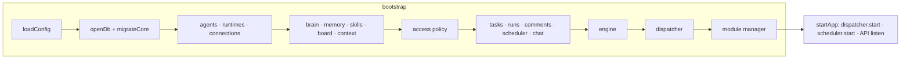
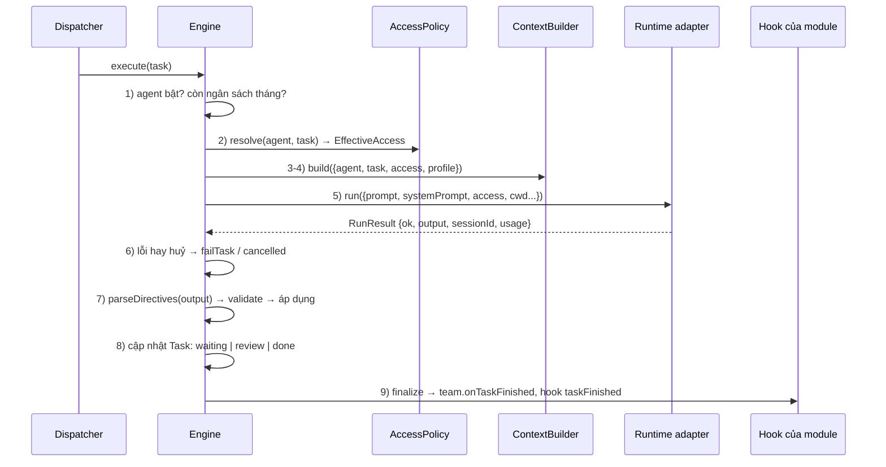

# Bài 1. Kiến trúc AIOS-Lite

Sau bài này bạn có thể:

- Gọi tên bốn tầng của lõi, tầng module, và nói mỗi tầng chịu trách nhiệm điều gì.
- Giải thích vì sao mọi lượt chạy agent đều đi qua một cổng duy nhất.
- Đi theo một việc từ lúc bạn bấm giao cho đến khi nó xong, chỉ ra từng hàm trong mã.

Bài này là bản đồ. Các bài sau đi sâu vào từng vùng.

## 1.1 Bức tranh tổng thể

AIOS-Lite chia làm **bốn tầng** và một lớp **module** nằm trên cùng. Quy tắc dễ nhớ: tầng trên chỉ được gọi tầng dưới, không gọi ngược.

```
┌─────────────────────────────────────────────────────────────────────┐
│ TẦNG APP         web/            giao diện Preact                      │
│                                   REST /api/*  ·  SSE /api/events      │
├─────────────────────────────────────────────────────────────────────┤
│ MODULE           modules/<id>/   care · zalo · gmail · marketing · ads │
│ (bấm Add)                        chỉ được dùng Module SDK (ctx.*)      │
├─────────────────────────────────────────────────────────────────────┤
│ TẦNG GIAO VIỆC   src/work/       Task → Dispatcher → Engine → Run      │
├───────────────────┬──────────────────────┬──────────────────────────┤
│ TẦNG AGENT        │ KIỂM SOÁT TRUY CẬP    │ TẦNG DÙNG CHUNG          │
│ src/agents/       │ src/access/           │ src/shared/              │
│ agent.yaml        │ policy → EffectiveAccess │ Second Brain · bộ nhớ │
│                   │                       │ skill · bảng đội · context│
├───────────────────┴──────────────────────┴──────────────────────────┤
│ TẦNG RUNTIME     src/runtimes/   claude · codex · grok · hermes · mock│
└─────────────────────────────────────────────────────────────────────┘
          ▼ tiến trình con, cờ quyền do adapter dịch ra
   claude -p │ codex exec │ grok --prompt-file │ hermes acp / chat
```

Cách đếm "bốn tầng": (1) **Runtime**, (2) **nền** gồm ba khối đứng cạnh nhau là Agent, Truy cập và Dùng chung, (3) **Giao việc**, (4) **App**. Module cắm vào giữa Giao việc và App: nó dùng lõi qua Module SDK và đưa màn hình lên App.

| Tầng | Thư mục | Nó trả lời câu hỏi |
|---|---|---|
| Runtime | `src/runtimes/` | "Gọi CLI nào, với cờ gì, và đọc kết quả ra sao?" |
| Agent | `src/agents/` | "Có những agent nào, cấu hình thế nào?" (đọc `agents/<id>/agent.yaml`) |
| Truy cập | `src/access/` | "Agent này được xem và làm gì?" (`policy.ts` tính ra `EffectiveAccess`) |
| Dùng chung | `src/shared/` | "Agent biết gì?" (Second Brain, bộ nhớ, skill, bảng hoạt động, bộ dựng prompt) |
| Giao việc | `src/work/` | "Việc nào chạy trước, chạy xong thì làm gì?" |
| Module | `modules/<id>/` | "Nghiệp vụ nào gắn thêm vào?" |
| App | `web/` | "Người dùng nhìn và bấm ở đâu?" |

## 1.2 Sáu nguyên tắc

Toàn bộ thiết kế xoay quanh sáu nguyên tắc. Khi đọc mã, bạn sẽ thấy chúng lặp đi lặp lại.

| # | Nguyên tắc | Nghĩa là | Thấy trong mã |
|---|---|---|---|
| 1 | Một nơi khai báo agent | Mọi thứ về agent nằm ở `agents/<id>/` | `src/agents/schema.ts:26` |
| 2 | Một cổng chạy | Mọi lượt chạy đều qua `engine.execute` | `src/work/engine.ts:169` |
| 3 | Một mô hình việc | Chat, lịch, giao việc, việc của module đều là Task | `src/core/types.ts:67` |
| 4 | Một tầng dùng chung | Bộ nhớ, brain, skill nạp ở cổng chạy | `src/shared/context.ts:59` |
| 5 | Policy quyết định, adapter thực thi | Một chỗ tính quyền, mỗi CLI tự dịch ra cờ | `src/access/policy.ts:36` |
| 6 | Mặc định không cấp gì | Không ghi trong `access` thì agent không có | `src/agents/schema.ts:16` |

Nguyên tắc 2 là quan trọng nhất. Vì chỉ có một cổng, mọi tính năng "đi kèm" (kiểm tra ngân sách, tính quyền, ghi nhật ký, tính chi phí) nằm ở **một chỗ**. Module trả lời khách hàng, lịch hằng tuần, người dùng bấm nút giao việc: tất cả đều thành một Task, rồi cùng đi qua cổng đó. Không có đường tắt gọi CLI.

## 1.3 Dữ liệu nằm ở đâu

| Loại | Nơi lưu | Vì sao |
|---|---|---|
| Agent, thư mục Second Brain, kết nối | File YAML (`agents/`, `config/`) | Sửa bằng tay được, đưa vào git được |
| Việc, lượt chạy, bộ nhớ, nhật ký, chỉ mục brain | SQLite `data/aios.db` | Cần truy vấn, sắp xếp, tìm toàn văn |
| Bảng của module | Cùng file SQLite, tiền tố riêng | Một DB, nhưng mỗi module chỉ đụng bảng của mình |
| Khoá bí mật | File `.env` | Không bao giờ vào prompt hay nhật ký |

Bảng của lõi nằm ở `src/core/migrations/001_core.ts`: `tasks`, `task_comments`, `runs`, `run_events`, `schedules`, `conversations`, `messages`, `memories`, `brain_docs`, `board`, `audit_log`, `attention`, `modules`, `kv` (cùng hai bảng FTS cho tìm kiếm). Ngoài ra `schema_migrations` do `src/core/db.ts:32` (`applyMigrations`) tạo để nhớ migration nào đã chạy, theo cặp (chủ sở hữu, id).

## 1.4 Một cổng chạy: các dịch vụ được nối thế nào

Mở `src/main.ts`. Hàm `bootstrap` (dòng 41) tạo mọi dịch vụ theo thứ tự phụ thuộc và gom lại thành một đối tượng `AppDeps` (khai báo ở `src/core/deps.ts:26`). Không có biến toàn cục: mỗi dịch vụ là một hàm `createXxx(deps)` nhận đúng những gì nó cần. Nhờ vậy test dựng được dịch vụ trên SQLite trong bộ nhớ.



`startApp` (dòng 102) thêm ba việc: `recoverOnBoot` (đưa việc đang chạy dở trước đó về hàng đợi, xem 1.7), khởi động module đã bật, rồi mở API. Nó cũng lập chỉ mục Second Brain lúc khởi động và 15 phút một lần (dòng 118).

## 1.5 Đi theo một việc

Ví dụ: bạn gõ lệnh sau (API đang chạy, xem README).

```bash
npm run aios -- task "Tóm tắt mục tiêu quý này" --agent demo --wait
```

### Bước A. Tạo Task

Lệnh gửi `POST /api/tasks` (`src/api/routes/tasks.ts:58`). Route ép `source` thành `user` hoặc `api` (client không tự nhận là agent hay module được), rồi gọi `tasks.create` (`src/work/tasks.ts`, hàm `create` quanh dòng 67).

`create` kiểm tra agent có thật, ghi một dòng vào bảng `tasks` với `status = 'queued'`, và phát sự kiện `task` lên bus. Hai giá trị đáng chú ý:

- `contextProfile`: lấy từ cài đặt `context` của agent (`standard` hay `lean`) nếu không chỉ định.
- `depth`: bằng độ sâu việc cha cộng một. Việc gốc có `depth = 0`.

### Bước B. Dispatcher nhận việc

Dispatcher (`src/work/dispatcher.ts`) lắng nghe sự kiện `task` có `status = 'queued'` (dòng 106) và còn quét định kỳ mỗi giây phòng khi lỡ. Hàm `pump` (dòng 79) lấy việc bằng **một câu SQL nguyên tử** `CLAIM_SQL` (dòng 22): chọn việc `queued` có ưu tiên cao nhất, chưa đến giờ thì bỏ qua (`run_after`), bỏ qua agent đã đủ số lượt chạy đồng thời, rồi đổi luôn sang `running` trong cùng câu lệnh. Hai worker không bao giờ lấy trùng một việc.

Giới hạn áp dụng ở đây:

| Giới hạn | Lấy từ | Chỗ kiểm tra |
|---|---|---|
| Số lượt chạy cùng lúc toàn hệ thống | `AIOS_MAX_PARALLEL` (mặc định 3) | `pump`, dòng 81 |
| Số lượt chạy cùng lúc của một agent | `max_concurrent` trong `agent.yaml` | `blockedAgents`, dòng 40 |
| Agent tắt | `enabled: false` | cũng trong `blockedAgents` |
| Nút dừng khẩn cấp | khoá `emergency_stop` trong bảng `kv` | `emergency`, dòng 38 |

### Bước C. Engine chạy việc

`engine.execute` (`src/work/engine.ts:169`) là trái tim. Đọc nó từ trên xuống, bạn thấy chín bước có đánh số trong chú thích:



Từng bước, kèm vị trí:

1. **Agent và ngân sách** (dòng 172 trở đi). Agent không tồn tại hoặc đang tắt: việc `failed` với nhóm lỗi `config`. Tổng chi phí tháng đã chạm `budget_usd_month`: `failed` với nhóm `budget` và một mục "cần bạn" được dựng lên.
2. **Tính quyền** (dòng 188): `deps.access.resolve(agent, task)` trả về `EffectiveAccess`. Chi tiết ở bài 3. Với agent chạy Claude hoặc Grok, engine còn liên kết (symlink) các skill được cấp vào thư mục làm việc của agent để CLI tự nhận.
3. **Gom đầu vào ngữ cảnh** (dòng 193 đến 199): cuộc trò chuyện, bình luận mới từ lần chạy trước, dữ liệu do module cung cấp (`moduleContext`, dòng 82), ảnh đính kèm.
4. **Dựng prompt** (dòng 212): `context.build(...)` trả `systemPrompt` và `prompt`. Việc `lean` và `standard` được dựng khác nhau (xem 1.6).
5. **Chạy runtime** (dòng 228): một lời gọi `runtime.run(...)`. Từ đây trở đi engine không biết CLI nào đang chạy, chỉ thấy interface `Runtime` ở `src/runtimes/contracts.ts:87`.
6. **Lỗi hay huỷ** (dòng 241 đến 253): kết quả lỗi được ghi vào Run, Task chuyển `failed` kèm nhóm lỗi (`auth`, `quota`, `transient`, `config`, `refusal`, `timeout`, `budget`, `access`, `cancelled`, `unknown`). Ba nhóm `auth`, `quota`, `config` còn tạo mục "cần bạn" vì chỉ con người sửa được (`engine.ts:22`).
7. **Chỉ thị** (dòng 256): engine đọc `<aios-task>`, `<aios-memory>`, `<aios-status>`, `<aios-action>` ở **câu trả lời cuối**, kiểm tra từng cái rồi mới áp dụng. Bài 5 nói kỹ.
8. **Trạng thái cuối** (dòng 265 đến 269): có việc con cần chờ thì `waiting`; agent xin duyệt thì `review`; còn lại `done`.
9. **Hook** (`finalize`, dòng 30): báo cho `team` (để đánh thức việc cha) rồi gọi mọi hook `taskFinished`. Module nhận kết quả việc do mình tạo qua hook này (bài 7).

Nếu có ngoại lệ bất ngờ, khối `catch` cuối hàm (dòng 278) đánh dấu Run và Task `failed` với "Lỗi nội bộ". Không việc nào bị treo ở `running`.

### Bước D. Ghi nhận và hiển thị

Mỗi thay đổi (Task đổi trạng thái, Run bắt đầu, sự kiện của Run, nhật ký mới) được phát lên bus (`src/core/events.ts`). Route SSE `src/api/sse.ts` chuyển bus ra trình duyệt qua `GET /api/events`. Đó là lý do trang Công việc cập nhật ngay không cần tải lại.

Lệnh `--wait` ở trên đơn giản là hỏi `GET /api/tasks/:id` mỗi giây cho đến khi trạng thái là một trong `done`, `failed`, `cancelled`, `review` (`src/cli/aios.ts`).

## 1.6 Hai mức ngữ cảnh: standard và lean

Một Task có `contextProfile`. Hai giá trị cho hai cách dùng khác nhau (`src/shared/contracts.ts:134` là bảng giới hạn thật):

| | `standard` (việc thường, chat) | `lean` (việc do module tạo) |
|---|---|---|
| Persona | có | có |
| Danh sách đồng đội, cách dùng chỉ thị | có | không |
| Skill | danh mục ngắn, agent tự mở file | **chép nguyên nội dung** skill vào prompt |
| Bộ nhớ, Second Brain | tối đa 8 / 4 mục | tối đa 3 / 3 mục |
| Bảng hoạt động đội | có | không |
| Dữ liệu từ module | không | có (đoạn hội thoại, hồ sơ khách...) |
| Công cụ của CLI | theo quyền | **không có công cụ, đúng một lượt** |

Lượt `lean` rẻ và nhanh, và quan trọng hơn là **an toàn**: nó dùng để trả lời khách, nơi nội dung đến từ người lạ. Không có công cụ thì lời lẽ độc hại trong tin nhắn khách không thể bắt agent chạy lệnh. Việc này do `policy.resolve` đặt `tools: 'none'` khi `contextProfile === 'lean'` (`src/access/policy.ts:78`).

## 1.7 "Không việc nào bị bỏ quên"

Máy tắt giữa chừng, tiến trình bị kill: việc đang `running` không được biến mất.

- Lúc khởi động, `recoverOnBoot` (`src/work/recovery.ts:4`) đánh dấu các Run còn `running` là thất bại, rồi đưa Task `running` về `queued` **một lần** (`recover_count`).
- Lần ngắt thứ hai, Task chuyển `failed` và hiện ở **Cần bạn**.
- Lịch định kỳ dùng chính sách `skip_missed`: nếu máy tắt qua giờ hẹn, lịch nhảy sang lần kế tiếp chứ không chạy bù ào ào (`src/work/scheduler.ts:104`).

## 1.8 Module nằm ở đâu trong bức tranh

Module không phải là tầng thứ năm có đường riêng. Nó là **khách** của lõi, nói chuyện qua một bề mặt hẹp là Module SDK (`src/modules/sdk.ts`):

- Module tạo Task bằng `ctx.tasks.create` hoặc `ctx.agents.runLean`. Hai cách đều dẫn tới cùng một cổng chạy.
- Module nhận kết quả bằng hook `onTaskFinished` (chỉ cho Task có `source = 'module:<id>'`).
- Module xin quyền bằng `ctx.access.can(agentId, scope)`.
- Module có bảng riêng, route riêng dưới `/api/m/<id>/*`, trang web riêng.

Khi bấm **Add**, `src/modules/manager.ts` (hàm `add`, dòng 240) kiểm tra điều kiện, chạy migration, nạp mã, cài agent mẫu, bật route. Remove tắt hết nhưng giữ dữ liệu; Purge mới xoá bảng. Bài 7 và 8 đi chi tiết.

## 1.9 Thử tay

Mọi lệnh dưới đây chạy được trên bản vừa clone, với `npm run dev` đang chạy.

```bash
# Xem các agent
npm run aios -- agents

# Giao việc cho agent mock và chờ
npm run aios -- task "Viết báo cáo #memory:Báo cáo gửi cho anh Nam" --agent demo --wait

# Việc đã được ghi: xem danh sách
npm run aios -- tasks --limit 5

# Bộ nhớ đã được ghi do chỉ thị <aios-memory> (bài 5)
npm run aios -- memory search "anh Nam"
```

Xem chi tiết Run và quyền đã dùng cho lượt chạy đó:

```bash
curl -s http://127.0.0.1:4380/api/tasks/1        # task, runs, children, comments
curl -s http://127.0.0.1:4380/api/runs/1         # run + events + access đã dùng
curl -s "http://127.0.0.1:4380/api/audit?limit=5"
```

Trường `accessJson` của Run là **bản chụp quyền** tại thời điểm chạy. Sau này dù bạn đổi `agent.yaml`, bản chụp cũ vẫn cho biết hôm đó agent được làm gì.

## Bài tập

1. Giao hai việc liên tiếp cho `demo`, rồi mở `GET /api/audit`. Tìm các dòng `run.start`. Mỗi dòng có `run_id` không? Dòng đó nối với bảng nào?
2. Đọc `src/work/dispatcher.ts` dòng 22 đến 29. Vì sao câu SQL dùng `UPDATE ... WHERE id = (SELECT ...) AND status = 'queued'` thay vì chọn rồi cập nhật bằng hai câu riêng? Điều gì xảy ra nếu hai worker chạy cùng lúc?
3. Giao `"Soạn thông báo #review"` cho `demo`. Task dừng ở trạng thái nào? Nó hiện ở đâu trên Tổng quan? Bấm duyệt và xem trạng thái đổi.
4. (Đọc mã) Trong `engine.ts`, tìm mọi chỗ gọi `failTask`. Liệt kê nhóm lỗi (`ErrorFamily`) mà mỗi chỗ đặt. Nhóm nào làm hiện mục "Cần bạn"?
5. Vẽ lại sơ đồ 1.5 bằng lời của bạn cho một việc **có việc con**: giao `"Viết báo cáo #delegate:tro-ly-thu"` cho `demo` (cần một agent mock tên `tro-ly-thu`, tạo ở bài 2). Task cha đi qua những trạng thái nào, và nó được đánh thức lại bằng hàm nào?
