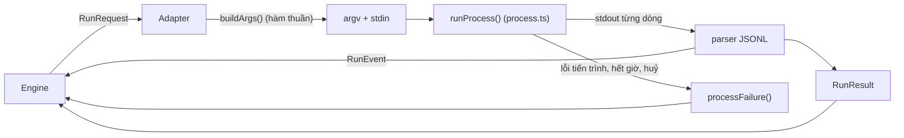

# Bài 4. Thêm một runtime mới

Sau bài này bạn có thể:

- Mô tả interface `Runtime` và vai trò của từng phần: `run`, `doctor`, `capabilities`.
- Dùng bộ chạy tiến trình dùng chung (`process.ts`) và đọc đầu ra JSON từng dòng đúng cách.
- Phân loại lỗi, xử lý nối phiên lỗi và trường hợp CLI từ chối nhưng vẫn thoát mã 0.
- Viết adapter cho một CLI giả định, kèm CLI giả để test, rồi nối nó vào hệ thống.

Bài này có ví dụ chạy được thật: adapter `zeta` bên dưới đã được dựng trên một bản sao của repo, vượt qua 9 test riêng và kiểm tra kiểu (`npm run typecheck`).

## 4.1 Vì sao một runtime chỉ là một adapter nhỏ

Engine không biết CLI nào đang chạy. Nó chỉ thấy interface ở `src/runtimes/contracts.ts:87`:

```ts
interface Runtime {
  id: RuntimeId;
  label: string;
  capabilities: RuntimeCapabilities;
  doctor(opts?: { probe?: boolean }): Promise<DoctorReport>;
  run(req: RunRequest): Promise<RunResult>;
}
```

Một lượt chạy là một vòng: **dịch yêu cầu thành dòng lệnh, chạy tiến trình, đọc từng dòng đầu ra, trả `RunResult`**.



### `RunRequest` (`contracts.ts:32`): adapter nhận gì

| Trường | Ý nghĩa |
|---|---|
| `agent` | `AgentConfig` đầy đủ: model, `runtimeOptions`, persona... |
| `access` | `EffectiveAccess` đã tính (bài 3): thư mục, MCP, biến môi trường, `permission` |
| `prompt`, `systemPrompt` | Do bộ dựng prompt soạn sẵn. Adapter chỉ chuyển cho CLI |
| `cwd` | Thư mục làm việc của agent |
| `sessionId` | Nối phiên cũ nếu `capabilities.resume` |
| `tools` | `'none'` cho lượt `lean`: không công cụ, một lượt |
| `images` | Đường dẫn ảnh (chỉ khi `capabilities.images`) |
| `signal`, `timeoutMs` | Huỷ và giới hạn thời gian |
| `onEvent` | Gọi cho mỗi sự kiện để UI hiện tiến trình trực tiếp |

### `RunResult` (`contracts.ts:58`): adapter trả gì

| Trường | Quy tắc |
|---|---|
| `ok`, `output` | `output` là **tin nhắn cuối** của agent, không phải đầu ra của công cụ. Engine đọc chỉ thị chỉ ở đây |
| `sessionId` | Để lượt sau nối tiếp |
| `clearSession` | `true` nếu phiên cũ hỏng và đã mở phiên mới: engine sẽ quên id cũ |
| `error` | `{ family, message, retryAfter? }` với `family` thuộc `ErrorFamily` |
| `usage` | **Thiếu thì để trống, không bao giờ điền 0.** 0 nghĩa là "không tốn", còn thiếu nghĩa là "không biết" |

### `capabilities` (`contracts.ts:19`): lời khai trung thực

Mỗi adapter khai CLI của nó làm được gì và chặn được gì:

| Trường | Ý nghĩa |
|---|---|
| `resume` | Có nối phiên được không |
| `systemPrompt` | `native` (CLI có cờ riêng) hay `inline` (adapter ghép vào đầu prompt) |
| `reportsCost`, `images`, `noTools` | Báo chi phí, nhận ảnh, chạy được không công cụ (lượt `lean`) |
| `enforces` | Mức chặn `hard`, `soft`, `none` cho `context`, `mcp`, `fileRead`, `fileWrite`, `shell` và một ghi chú tiếng Việt |

`enforces` hiện nguyên văn ở tab Quyền của agent (bài 3). **Khai thật, đừng khai đẹp.** Một test (`src/runtimes/index.test.ts`) kiểm tra bảng này: ví dụ Codex phải khai `fileRead: 'none'`.

## 4.2 Bộ chạy tiến trình dùng chung

Đừng tự gọi `child_process.spawn`. Dùng `runProcess` ở `src/runtimes/process.ts:187`, nó đã giải quyết những chuyện khó:

| Việc | Cách làm |
|---|---|
| Không qua shell | `spawn(..., { shell: false })`: prompt có ký tự lạ không thành lệnh |
| Tách nhóm tiến trình | `detached: true` + `kill(-pid)`: giết cả cây tiến trình con |
| Hết giờ hoặc bị huỷ | SIGTERM, chờ `graceMs` (5 giây), rồi SIGKILL |
| Đọc từng dòng | `createLineSplitter` (`process.ts:60`) ghép mảnh byte, giải mã UTF-8 đúng, bỏ dòng dài hơn 8 MiB |
| stderr | Giữ 16 KiB cuối trong `stderrTail`, không tràn bộ nhớ |
| Prompt | Ghi vào stdin rồi đóng, để prompt không lộ trong `ps` |
| Tiến trình mồ côi | Sau khi đóng, giết nhóm còn sót để không rò tiến trình |

Quanh đó, `src/runtimes/shared.ts` có các hàm dùng chung:

| Hàm | Dùng để |
|---|---|
| `buildChildEnv` (dòng 34) | Dựng môi trường cho CLI: bỏ `AIOS_TOKEN`, `AIOS_ENCRYPTION_KEY`, `COMPOSIO_API_KEY` và biến `CLAUDECODE*`, rồi cộng các biến được cấp |
| `findBinary` (dòng 89) | Tìm CLI theo tên trên `PATH` và vài thư mục quen thuộc (`~/.local/bin`, `/opt/homebrew/bin`...) |
| `createRunDir` (dòng 58) | Thư mục tạm `<cwd>/.aios/run-xxxx/` (quyền 0600) cho file prompt hoặc cấu hình MCP; xoá sau lượt chạy |
| `processFailure` (dòng 126) | Đổi lỗi tiến trình (không tìm thấy lệnh, hết giờ, bị huỷ) thành `RunError` |
| `classifyMessage` (dòng 117) | Đoán nhóm lỗi từ **thông điệp lỗi đã được CLI báo** |
| `emitSafe`, `failed`, `makeReport`, `execFileText` | Phát sự kiện không sập, dựng kết quả lỗi, dựng báo cáo doctor, chạy lệnh ngắn |
| `describeCommand` (`jsonl.ts:29`) | Dựng dòng lệnh để ghi nhật ký, che prompt và khoá |

## 4.3 Đọc JSONL

Hầu hết CLI agent có chế độ in mỗi sự kiện thành một dòng JSON (Claude `--output-format stream-json`, Codex `--json`, Grok `streaming-json`). Quy tắc:

1. **Mỗi dòng là một đối tượng JSON.** `parseJsonLine` (`jsonl.ts:7`) trả `null` cho dòng nhiễu: banner, log, mảng, JSON hỏng. Adapter **bỏ qua** dòng nhiễu thay vì sập.
2. **Phát `RunEvent`** để UI thấy tiến trình: `text`, `thinking`, `tool`, `status`, `usage` (định nghĩa ở `src/core/types.ts`).
3. **`output` là tin nhắn cuối.** Claude và Codex phát cả khối tin nhắn; Grok và Hermes phát từng mẩu (delta). Người nhận ghép lại nếu muốn, nhưng `RunResult.output` luôn là tin cuối.
4. **Token vào đã gồm cache** ở mọi runtime: Claude cộng `cache_read + cache_creation`; Codex vốn đã gồm sẵn, đừng cộng thêm lần nữa (một cái bẫy đã gặp).

## 4.4 Lỗi: phân nhóm đúng thì hệ thống xử lý đúng

`ErrorFamily` (`src/core/types.ts`) là `auth`, `quota`, `transient`, `config`, `refusal`, `timeout`, `budget`, `access`, `cancelled`, `unknown`. Engine dựa vào nhóm này: `auth`, `quota`, `config` làm hiện mục "Cần bạn" (chỉ người mới sửa được), `transient` đáng thử lại, `cancelled` không phải lỗi.

Những cái bẫy đã gặp khi kiểm với CLI thật (xem `docs/dev/runtime-verification.md`):

| Bẫy | Cách xử lý |
|---|---|
| Claude từ chối nhưng thoát mã 0 | Nhận ra qua `stop_reason: refusal`, trả `family: 'refusal'` |
| Nối phiên (`--resume`) lỗi vì phiên hết hạn | Chạy lại **đúng một lần** với phiên mới và trả `clearSession: true` |
| `classifyMessage` đoán nhầm nếu đưa stderr thô vào | Chỉ đưa thông điệp lỗi do CLI báo trong kết quả đã phân tích, không đưa stderr thô |
| Khi nối phiên | Chỉ gửi tin mới, không gửi lại system prompt |
| Grok `--rules @file` không đọc file | Truyền nội dung chứ không truyền `@file` |

## 4.5 `doctor`: kiểm tra trước khi tin

`doctor` trả `DoctorReport` gồm các `checks` mức `info`, `warn`, `error`. Quy ước của các adapter hiện có:

1. Có lệnh không (`findBinary`)? Không thì dừng ngay với `error` và gợi ý cài.
2. Phiên bản (`--version`).
3. Đã đăng nhập chưa (tuỳ CLI: file `auth.json`, biến môi trường, lệnh `auth status`).
4. Cảnh báo giới hạn (ví dụ Codex: không chặn đọc file).
5. Chỉ khi `probe: true`: gửi thử một câu "hello" bằng `probeCheck` (`src/runtimes/probe.ts:38`). Việc này **tốn một lượt gọi thật**, nên mặc định không làm.

`GET /api/runtimes` gọi `doctor()` cho từng runtime (không probe); thêm `?probe=1` để gửi thử. Trang **Cài đặt** hiển thị kết quả.

## 4.6 Test bằng CLI giả

Không test adapter bằng CLI thật: chậm, tốn tiền, và không lặp lại được. Repo có sẵn khuôn:

- `test-fixtures/runtimes/fake-*.mjs`: các CLI giả. Hành vi chọn bằng biến môi trường `FAKE_SCENARIO`; `FAKE_RECORD=<file>` ghi lại argv, stdin, môi trường để test kiểm.
- `src/runtimes/test-util.ts`: `makeReq(cwd, {...})` dựng một `RunRequest` mẫu, `tmpCwd()`, `fixture(name)`.
- Adapter nhận đường dẫn lệnh qua đối số `command`, nên test trỏ nó vào CLI giả: `createZetaRuntime(fixture('fake-zeta.mjs'), { FAKE_SCENARIO: 'ok' })`.

Mẹo: file CLI giả phải có quyền chạy (`chmod +x`), vì `findBinary` kiểm tra quyền thực thi cho đường dẫn tuyệt đối.

Tách hàm dựng cờ thành **hàm thuần** `buildXxxArgs(req)` là thói quen quan trọng nhất của lớp này: test nó không cần tiến trình nào, và bạn thấy ngay quyền được dịch thành cờ gì.

## 4.7 Ví dụ: adapter cho CLI `zeta` (giả định)

Giả sử có CLI `zeta` với hành vi sau:

- Chạy: `zeta run --json --cwd <dir> [--model m] [--resume id] [--sandbox workspace|off | --no-tools --max-turns 1]`, prompt đọc từ stdin.
- Mỗi dòng stdout là JSON: `{"type":"session","id":...}`, `{"type":"text","text":...}`, `{"type":"done","input_tokens":N,"output_tokens":N}` hoặc `{"type":"error","message":...}`.
- Chỉ có sandbox ghi; không chặn đọc file, không có MCP, không có cờ system prompt.

### Bước 1. Khai id

Mở `src/core/types.ts` và thêm `'zeta'` vào **hai chỗ** (kiểu và danh sách). Schema `agent.yaml` và schema API lấy danh sách này nên tự nhận id mới.

```ts
export type RuntimeId = 'claude' | 'codex' | 'grok' | 'hermes' | 'zeta' | 'mock';
export const RUNTIME_IDS: readonly RuntimeId[] = ['claude', 'codex', 'grok', 'hermes', 'zeta', 'mock'];
```

### Bước 2. Viết adapter: `src/runtimes/zeta.ts`

```ts
// Zeta adapter (CLI giả định): `zeta run --json`, prompt qua stdin, mỗi dòng stdout là một JSON.
import type { RunEvent, Usage } from '../core/types.js';
import { redactString } from '../core/redact.js';
import type { DoctorCheck, Runtime, RuntimeCapabilities, RunRequest, RunResult } from './contracts.js';
import { describeCommand, num, parseJsonLine, str } from './jsonl.js';
import { log } from '../core/log.js';
import { probeCheck } from './probe.js';
import { runProcess } from './process.js';
import { buildChildEnv, classifyMessage, emitSafe, execFileText, failed, findBinary, makeReport, processFailure, stderrSummary } from './shared.js';

export const ZETA_CAPABILITIES: RuntimeCapabilities = {
  resume: true,
  systemPrompt: 'inline', // Zeta không có cờ system prompt: adapter ghép vào đầu prompt
  reportsCost: false,
  images: false,
  noTools: true,
  enforces: {
    context: 'hard', // bộ nhớ, Second Brain, dữ liệu module do AIOS quyết định đưa vào prompt: luôn chặn cứng
    mcp: 'none',
    fileRead: 'none',
    fileWrite: 'hard', // chỉ ghi được trong thư mục làm việc nhờ cờ --sandbox
    shell: 'soft',
    note: 'Zeta chỉ có sandbox ghi; không chặn được đọc file ngoài thư mục làm việc.',
  },
};

/** Hàm thuần: RunRequest -> argv + stdin. Dễ test, không chạy tiến trình. */
export function buildZetaArgs(req: RunRequest, opts: { fresh?: boolean } = {}): { args: string[]; stdin: string } {
  const lean = req.tools === 'none';
  const resume = !opts.fresh && req.sessionId ? req.sessionId : undefined;
  const args = ['run', '--json', '--cwd', req.cwd];
  if (req.agent.model) args.push('--model', req.agent.model);
  if (resume) args.push('--resume', resume);
  if (lean) args.push('--no-tools', '--max-turns', '1');
  else args.push('--sandbox', req.access.permission === 'full' ? 'off' : 'workspace');
  const stdin = !resume && req.systemPrompt.trim() ? `${req.systemPrompt.trim()}\n\n---\n\n${req.prompt}` : req.prompt;
  return { args, stdin };
}

interface ZetaParse {
  sessionId?: string;
  text: string;
  usage?: Usage;
  error?: string;
  done: boolean;
}

export function createZetaParser(onEvent: (e: RunEvent) => void) {
  const st: ZetaParse = { text: '', done: false };
  return {
    feed(line: string) {
      const ev = parseJsonLine(line);
      if (!ev) return; // dòng nhiễu (log, banner) bị bỏ qua
      switch (str(ev.type)) {
        case 'session':
          st.sessionId = str(ev.id) ?? st.sessionId;
          break;
        case 'text': {
          const t = str(ev.text) ?? '';
          st.text = t; // RunResult.output là tin nhắn cuối, không phải mọi tin nối lại
          if (t) onEvent({ type: 'text', text: t });
          break;
        }
        case 'done': {
          st.done = true;
          const usage: Usage = {};
          const input = num(ev.input_tokens);
          const output = num(ev.output_tokens);
          if (input !== undefined) usage.inputTokens = input; // thiếu thì để trống, không điền 0
          if (output !== undefined) usage.outputTokens = output;
          if (Object.keys(usage).length) {
            st.usage = usage;
            onEvent({ type: 'usage', usage });
          }
          break;
        }
        case 'error':
          st.error = str(ev.message) ?? st.error;
          break;
      }
    },
    finish: () => st,
  };
}

const RE_RESUME_FAIL = /unknown session|session .* not found/i;

export function createZetaRuntime(command = 'zeta', extraEnv?: Record<string, string>): Runtime {
  async function runOnce(req: RunRequest, bin: string, fresh: boolean): Promise<{ result: RunResult; resumeFailed: boolean }> {
    const built = buildZetaArgs(req, { fresh });
    const env = buildChildEnv({ envVars: req.access.envVars, extra: extraEnv });
    log.debug({ cmd: describeCommand(bin, built.args) }, 'zeta run');
    const parser = createZetaParser((e) => emitSafe(req, e));
    const proc = await runProcess({ command: bin, args: built.args, cwd: req.cwd, env, stdin: built.stdin, timeoutMs: req.timeoutMs, signal: req.signal, onStdoutLine: (l) => parser.feed(l) });
    const p = parser.finish();
    const pf = processFailure('Zeta', proc, command); // ENOENT, hết giờ, bị huỷ
    if (pf) return { result: failed(pf, { sessionId: p.sessionId, output: p.text }), resumeFailed: false };
    if (p.done && !p.error) return { result: { ok: true, output: p.text, sessionId: p.sessionId ?? req.sessionId, model: req.agent.model, usage: p.usage }, resumeFailed: false };
    const message = redactString(p.error ?? (stderrSummary(proc) || `Zeta kết thúc (mã ${proc.exitCode ?? proc.signal}) mà không hoàn tất lượt.`));
    const resumeFailed = !fresh && !!req.sessionId && RE_RESUME_FAIL.test(`${message}\n${proc.stderrTail}`);
    return { result: failed({ family: classifyMessage(message), message }, { output: p.text, sessionId: p.sessionId, usage: p.usage }), resumeFailed };
  }

  return {
    id: 'zeta',
    label: 'Zeta',
    capabilities: ZETA_CAPABILITIES,
    async run(req) {
      const bin = (await findBinary(command)) ?? command;
      const first = await runOnce(req, bin, false);
      if (!first.resumeFailed) return first.result;
      const second = await runOnce(req, bin, true); // nối phiên lỗi: mở phiên mới đúng một lần
      return { ...second.result, clearSession: true };
    },
    async doctor(opts) {
      const checks: DoctorCheck[] = [];
      const bin = await findBinary(command);
      if (!bin) {
        checks.push({ code: 'zeta.missing', level: 'error', message: `Không tìm thấy lệnh "${command}".`, hint: 'Cài Zeta rồi chạy lại.' });
        return makeReport('zeta', checks, { command });
      }
      const v = await execFileText(bin, ['--version'], { env: buildChildEnv({ extra: extraEnv }) });
      const version = v.ok ? v.stdout.trim().split('\n')[0] : undefined;
      checks.push(v.ok ? { code: 'zeta.version', level: 'info', message: `Phiên bản: ${version}` } : { code: 'zeta.version', level: 'error', message: 'Không đọc được phiên bản.' });
      if (opts?.probe && checks.every((c) => c.level !== 'error')) {
        checks.push(await probeCheck('zeta', (r) => this.run(r)));
      }
      return makeReport('zeta', checks, { version, command: bin });
    },
  } satisfies Runtime;
}
```

Chú ý những quyết định nhỏ nhưng quan trọng:

- `buildZetaArgs` là hàm thuần và là nơi duy nhất dịch `RunRequest` thành cờ. Lượt `lean` (`tools === 'none'`) thành `--no-tools --max-turns 1`.
- `st.text = t` thay vì nối chuỗi: `output` là tin cuối.
- Thiếu `input_tokens` thì **không đặt** `usage.inputTokens`.
- Prompt đi qua stdin (`stdin: built.stdin`), không nằm trong `argv`.
- Lỗi lấy từ thông điệp `error` do CLI báo, rồi mới qua `classifyMessage` (`rate limit reached` thành `quota`).
- `capabilities.enforces` khai đúng: `mcp: 'none'` vì Zeta không có MCP, `fileRead: 'none'` vì không chặn đọc.

### Bước 3. Đăng ký adapter: `src/runtimes/index.ts`

```ts
import { createZetaRuntime } from './zeta.js';
// ...
for (const rt of [createClaudeRuntime(cmd.claude, env), createCodexRuntime(cmd.codex, env), createGrokRuntime(cmd.grok, env),
  createHermesRuntime(cmd.hermes, env), createZetaRuntime(cmd.zeta, env), createMockRuntime()]) map.set(rt.id, rt);
```

`cmd.zeta` cho phép ghi đè đường dẫn lệnh (tuỳ chọn `commands` của `createRuntimeRegistry`), dùng trong test.

### Bước 4. Nhãn trên giao diện

Hai bảng tra theo `RuntimeId` buộc bạn phải bổ sung (trình biên dịch sẽ báo nếu quên):

```ts
// web/src/lib/labels.ts
export const RUNTIME_LABEL: Record<RuntimeId, string> = { /* ... */ zeta: 'Zeta', mock: 'Mock' };
// web/src/pages/agents/AgentsPage.tsx
const TONE: Record<AgentSummary['runtime'], string> = { /* ... */ zeta: 'slate', mock: 'sand' };
```

> **Lưu ý về tài liệu thiết kế.** `ARCHITECTURE.md` nói "thêm runtime mới chỉ cần thêm một file". Thực tế là **một file adapter cộng ba chỗ khai báo** (`types.ts`, `index.ts` và các bảng nhãn của web). Vẫn nhỏ, nhưng đừng bất ngờ.

### Bước 5. CLI giả: `test-fixtures/runtimes/fake-zeta.mjs`

```js
#!/usr/bin/env node
// CLI Zeta giả: hành vi theo biến FAKE_SCENARIO (ok | error | noise).
import { appendFileSync } from 'node:fs';
const args = process.argv.slice(2);
if (args.includes('--version')) { console.log('zeta 0.1.0'); process.exit(0); }
let stdin = '';
for await (const c of process.stdin) stdin += c;
if (process.env.FAKE_RECORD) appendFileSync(process.env.FAKE_RECORD, `${JSON.stringify({ argv: args, stdin })}\n`);
const out = (o) => process.stdout.write(`${JSON.stringify(o)}\n`);
const scenario = process.env.FAKE_SCENARIO ?? 'ok';
if (scenario === 'noise') console.log('banner: zeta v0.1.0');
out({ type: 'session', id: 'z-123' });
if (scenario === 'error') { out({ type: 'error', message: 'rate limit reached' }); process.exit(1); }
out({ type: 'text', text: 'xin chào từ zeta' });
out({ type: 'done', input_tokens: 12, output_tokens: 4 });
```

Sau khi tạo: `chmod +x test-fixtures/runtimes/fake-zeta.mjs`.

### Bước 6. Test: `src/runtimes/zeta.test.ts`

```ts
import { readFile } from 'node:fs/promises';
import path from 'node:path';
import { describe, expect, it } from 'vitest';
import { buildZetaArgs, createZetaRuntime } from './zeta.js';
import { fixture, makeReq, tmpCwd } from './test-util.js';

describe('buildZetaArgs', () => {
  it('safe: sandbox workspace, system prompt ghép vào stdin', () => {
    const { args, stdin } = buildZetaArgs(makeReq('/w', { agent: { model: 'z-1' } }));
    expect(args).toEqual(['run', '--json', '--cwd', '/w', '--model', 'z-1', '--sandbox', 'workspace']);
    expect(stdin).toBe('Bạn là trợ lý.\n\n---\n\nxin chào');
  });

  it('lean (tools none): không công cụ, một lượt', () => {
    expect(buildZetaArgs(makeReq('/w', { tools: 'none' })).args).toEqual(expect.arrayContaining(['--no-tools', '--max-turns', '1']));
  });

  it('nối phiên: gửi --resume và không gửi lại system prompt', () => {
    const { args, stdin } = buildZetaArgs(makeReq('/w', { sessionId: 'z-9' }));
    expect(args).toEqual(expect.arrayContaining(['--resume', 'z-9']));
    expect(stdin).toBe('xin chào');
  });
});

describe('createZetaRuntime (CLI giả)', () => {
  const rt = (scenario: string, record?: string) => createZetaRuntime(fixture('fake-zeta.mjs'), { FAKE_SCENARIO: scenario, ...(record ? { FAKE_RECORD: record } : {}) });

  it('ok: đọc JSONL, trả tin cuối, sessionId và usage', async () => {
    const req = makeReq(await tmpCwd());
    const res = await rt('ok').run(req);
    expect(res).toMatchObject({ ok: true, output: 'xin chào từ zeta', sessionId: 'z-123', usage: { inputTokens: 12, outputTokens: 4 } });
    expect(req.events.map((e) => e.type)).toEqual(['text', 'usage']);
  });

  it('bỏ qua dòng nhiễu không phải JSON', async () => {
    expect((await rt('noise').run(makeReq(await tmpCwd()))).ok).toBe(true);
  });

  it('lỗi hạn mức được phân loại thành quota', async () => {
    const res = await rt('error').run(makeReq(await tmpCwd()));
    expect(res.ok).toBe(false);
    expect(res.error?.family).toBe('quota');
  });

  it('thiếu CLI: family config', async () => {
    const res = await createZetaRuntime('/khong/co/zeta').run(makeReq(await tmpCwd()));
    expect(res.error?.family).toBe('config');
  });

  it('prompt đi qua stdin, không nằm trong argv', async () => {
    const cwd = await tmpCwd();
    const record = path.join(cwd, 'rec.jsonl');
    await rt('ok', record).run(makeReq(cwd, { prompt: 'bí mật của khách' }));
    const line = JSON.parse((await readFile(record, 'utf8')).trim().split('\n')[0]!);
    expect(line.stdin).toContain('bí mật của khách');
    expect(JSON.stringify(line.argv)).not.toContain('bí mật');
  });

  it('doctor báo phiên bản', async () => {
    const r = await rt('ok').doctor();
    expect(r.status).toBe('pass');
    expect(r.version).toBe('zeta 0.1.0');
  });
});
```

Chạy:

```bash
npx vitest run src/runtimes/zeta.test.ts
```

Kết quả khi chạy thật trên bản sao: `9 passed`.

### Bước 7. Cập nhật test danh sách runtime

`src/runtimes/index.test.ts` kiểm tra danh sách id đầy đủ. Thêm `'zeta'` vào mảng mong đợi (sắp xếp theo thứ tự chữ cái: `['claude', 'codex', 'grok', 'hermes', 'mock', 'zeta']`). Nếu quên bước này, đó là test duy nhất sẽ đỏ (đã gặp khi thử: 1 test lỗi trên 120, sau khi sửa cả 120 đều xanh).

### Bước 8. Dùng thử

Đặt `runtime: zeta` vào `agent.yaml` của một agent. Mở tab **Quyền** của agent để thấy bảng chặn mà bạn đã khai. `GET /api/runtimes` sẽ có thêm dòng `zeta`, và nếu CLI chưa cài, `doctor` báo `Không tìm thấy lệnh "zeta"`.

Cuối cùng kiểm tra toàn bộ:

```bash
npm run typecheck      # đã chạy thật: không lỗi
npx vitest run src/runtimes
```

## 4.8 Danh sách kiểm tra cho runtime mới

- [ ] `buildXxxArgs` là hàm thuần, có test cho: `safe`, `full`, `lean`, nối phiên, có và không có thư mục được cấp.
- [ ] Prompt không nằm trong `argv`; khoá bí mật không nằm trong `argv`.
- [ ] Môi trường của CLI đi qua `buildChildEnv`.
- [ ] `usage` thiếu thì để trống.
- [ ] `output` là tin cuối, không phải đầu ra công cụ.
- [ ] Nối phiên lỗi: thử lại đúng một lần và `clearSession: true`.
- [ ] Từ chối của mô hình (`refusal`) được nhận ra, kể cả khi CLI thoát mã 0.
- [ ] Hết giờ và huỷ trả `timeout` và `cancelled` (đã do `processFailure` lo).
- [ ] `enforces` khai đúng sau khi **kiểm thật** từng điều: đọc ngoài thư mục, ghi, shell, MCP trái phép.
- [ ] `doctor` báo thiếu lệnh, phiên bản, đăng nhập, giới hạn đã biết.
- [ ] Cập nhật `docs/dev/runtime-verification.md` với kết quả kiểm thật.

## Bài tập

1. Chạy thật bài này trên một bản sao repo: tạo các file ở 4.7, chạy test của `zeta`. Cố ý sửa `fake-zeta.mjs` (đổi `rate limit reached` thành `boom`). Test nào đỏ, và `family` mới là gì (gợi ý: `classifyMessage`)?
2. Thêm kịch bản `resumefail` vào CLI giả: khi có `--resume` thì in `{"type":"error","message":"unknown session z-9"}` và thoát mã 1. Viết test chứng minh adapter thử lại một lần và trả `clearSession: true`.
3. Thêm hỗ trợ `runtime_options.mode`: khi bằng `fast`, thêm cờ `--fast` vào lệnh. Viết test cho `buildZetaArgs`. Đọc `runtimeOptionString` trong `shared.ts` để lấy giá trị.
4. Thử đặt `FAKE_SCENARIO=noise` trong test hiện có và quan sát: banner không phải JSON bị bỏ qua. Vì sao điều này quan trọng với CLI thật?
5. (Đọc mã) So `createCodexRuntime` (`codex.ts:173`) với `createZetaRuntime`: adapter Codex có thêm gì (gợi ý: `exec resume`, `--ephemeral`, biến môi trường cho MCP)? Vì sao Zeta không cần?
