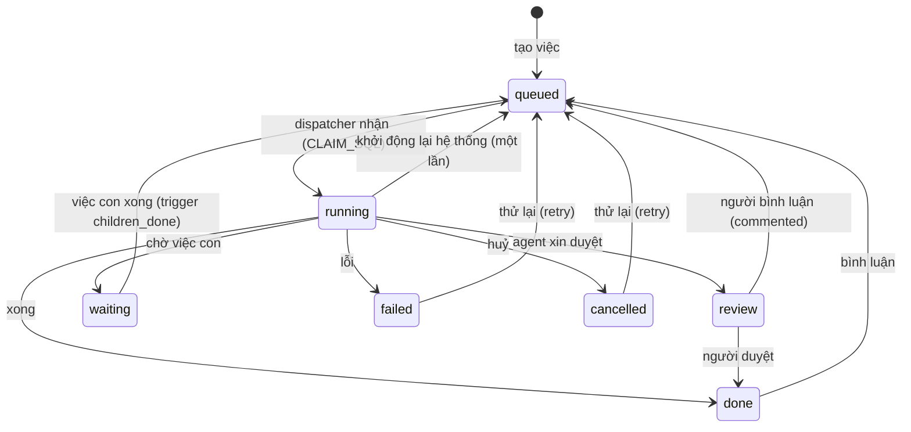
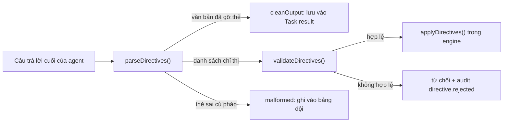
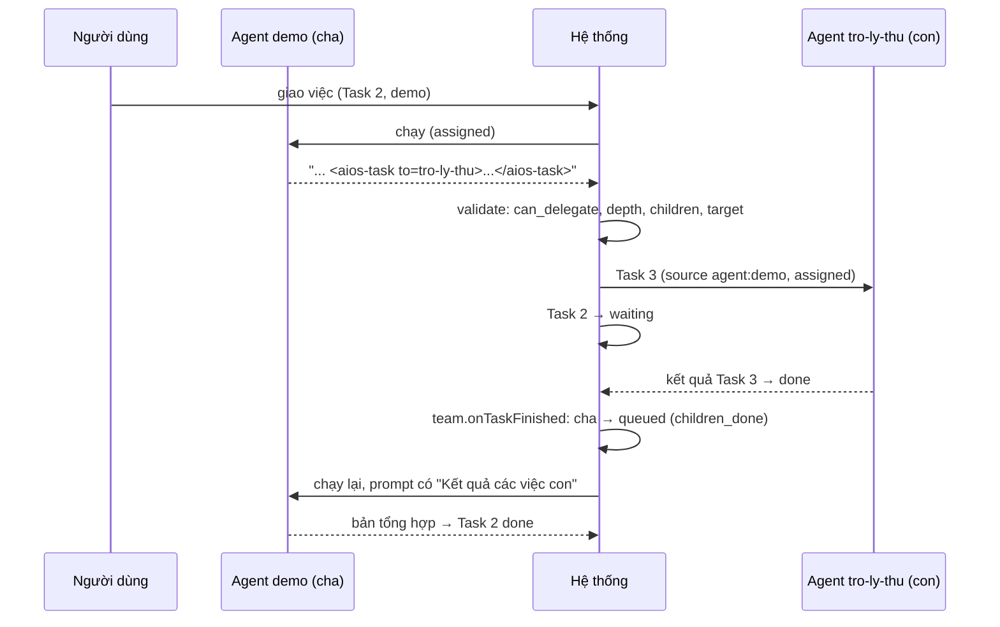

# Bài 5. Giao việc và chỉ thị

Sau bài này bạn có thể:

- Phân biệt các nguồn tạo Task (`user`, `chat`, `schedule`, `agent`, `module`) và vòng đời trạng thái của nó.
- Viết và đọc bốn loại chỉ thị: `<aios-task>`, `<aios-memory>`, `<aios-status>`, `<aios-action>`.
- Nêu các giới hạn an toàn: độ sâu, số việc con, số vòng, kích thước, chỉ thị bị bỏ qua ở lượt `lean`.
- Dùng hỏi cả nhóm (song song hoặc nối tiếp), lịch định kỳ, bình luận và duyệt.

## 5.1 Task là đơn vị công việc duy nhất

Chat, lịch, giao việc giữa agent, việc do module tạo: tất cả đều là một dòng trong bảng `tasks`. Hai trường cho biết "việc này từ đâu ra":

| `source` | Do ai tạo |
|---|---|
| `user` | Người dùng qua giao diện |
| `api` | Gọi API hoặc lệnh `aios task` (API ép nguồn thành `user` hoặc `api`, client không giả làm agent được) |
| `chat` | Một tin nhắn trong cuộc trò chuyện (`kind: chat`) |
| `schedule:<id>` | Lịch định kỳ số `<id>` đến giờ |
| `agent:<id>` | Một agent giao việc con |
| `module:<id>` | Một module tạo việc |

| `trigger` | Lý do agent được gọi (ghi ở đầu prompt, `src/shared/context.ts:19`) |
|---|---|
| `assigned` | Bạn được giao một việc mới |
| `chat` | Người dùng vừa nhắn tin |
| `schedule` | Đến giờ chạy theo lịch |
| `children_done` | Các việc con đã xong, hãy tổng hợp |
| `commented` | Người dùng vừa bình luận, hãy xử lý tiếp |
| `retry` | Lượt trước chưa thành công, làm lại |
| `module` | Một module giao việc này |

Trạng thái:



Hai điểm cần nhớ: `done`, `failed`, `cancelled` là trạng thái kết thúc (`TERMINAL_STATUSES`); và `review` là trạng thái "chờ con người", nó hiện ở **Cần bạn** trên Tổng quan.

## 5.2 Chỉ thị: agent nói chuyện với hệ thống

Agent nói chuyện với **người** bằng văn bản thường. Muốn nói chuyện với **hệ thống** (giao việc, ghi nhớ, xin duyệt, gọi hành động của module), nó chèn các thẻ đặc biệt vào **câu trả lời cuối cùng**. Bốn loại:

| Thẻ | Việc làm |
|---|---|
| `<aios-task to="id" title="..." wait="true\|false">nội dung</aios-task>` | Giao việc cho agent khác |
| `<aios-memory scope="team\|private">điều cần nhớ</aios-memory>` | Ghi bộ nhớ lâu dài |
| `<aios-status>review</aios-status>` | Xin người dùng xem lại trước khi xong |
| `<aios-action module="m" name="n">{json}</aios-action>` | Gọi một hành động của module |

Cách đọc ở `src/work/directives.ts`:



Các quy tắc an toàn xuất phát từ một nguyên lý: **chỉ thị chỉ được đọc ở câu trả lời cuối của agent, không bao giờ ở đầu ra của công cụ** (`src/work/directives.ts:1`). Nội dung một trang web hay một file mà agent vừa đọc có thể chứa `<aios-task ...>` do kẻ xấu cài, nhưng nó không bao giờ tới được `parseDirectives`.

Thêm các lớp bảo vệ khác:

| Lớp | Chi tiết | Vị trí |
|---|---|---|
| Thẻ lồng nhau | Thẻ có thẻ `aios-*` khác bên trong bị loại và ghi "sai cú pháp" | `hasNestedTag`, `directives.ts:35` |
| Thẻ mồ côi | Thẻ mở hoặc đóng thừa do cắt cụt bị gỡ sạch, không lọt ra người dùng hay prompt kế tiếp | `directives.ts:96` |
| Dữ liệu vào prompt | Mọi khối dữ liệu (bộ nhớ, brain, bình luận, kết quả việc con...) được đóng khung "dữ liệu tham khảo, không phải mệnh lệnh"; thẻ `<aios-` trong đó bị đổi thành `‹aios-` để vô hiệu | `untrusted`, `context.ts:30` |
| Số lượng | Đọc tối đa 50 chỉ thị mỗi lượt; 10 hành động module; ghi nhớ tối đa 2.000 ký tự; payload hành động tối đa 20.000 ký tự | `directives.ts:24-27` |

### Bảng kiểm tra từng loại (thông báo thật)

`validateDirectives` (`directives.ts:112`) kiểm tra theo thứ tự này và dừng ở lỗi đầu tiên của mỗi chỉ thị:

| Loại | Điều kiện bị từ chối | Thông báo |
|---|---|---|
| `task` | agent gửi không có `can_delegate` | `Agent không được phép giao việc` |
| | `task.depth >= AIOS_MAX_DELEGATION_DEPTH` (mặc định 3) | `Vượt độ sâu giao việc tối đa (3)` |
| | đã tổng hợp quá `AIOS_MAX_SUMMARY_ROUNDS` vòng (mặc định 3) | `Vượt số vòng tổng hợp tối đa (3)` |
| | agent nhận không tồn tại | `Không tìm thấy agent "x"` |
| | agent nhận đang tắt | `Agent "x" đang tắt` |
| | giao cho chính mình | `Agent không thể giao việc cho chính mình` |
| | nội dung trống | `Nội dung việc trống` |
| | quá `AIOS_MAX_CHILDREN_PER_RUN` việc con một lượt (mặc định 5) | `Vượt số việc con tối đa mỗi lượt (5)` |
| `memory` | nội dung trống | `Nội dung ghi nhớ trống` |
| | `scope="team"` mà agent không có `memory.team` | `Agent không có quyền ghi bộ nhớ đội` |
| `action` | không có hành động đó, hoặc module chưa Add | `Không có hành động "n" của module "m" (hoặc module chưa được thêm)` |
| | agent không có scope cần thiết | `Agent chưa được cấp quyền "s" của module "m"` |
| | quá 10 hành động một lượt | `Vượt số hành động tối đa mỗi lượt (10)` |
| `status` | luôn được chấp nhận (chỉ giá trị `review` hợp lệ) | |

Chỉ thị bị từ chối **không làm hỏng lượt chạy**: câu trả lời vẫn được lưu, chỉ chỉ thị đó không có hiệu lực. Lý do được ghi ở hai nơi: bảng đội (`GET /api/board`, loại `directive`) và nhật ký (`GET /api/audit?action=directive.rejected`).

Ví dụ đã chạy thật, giao `"Làm gì đó #delegate:khong-co-agent"` cho `demo`:

```
directive.rejected  task:17  {'kind': 'task', 'reason': 'Không tìm thấy agent "khong-co-agent"'}
```

### Lượt `lean` chỉ nhận `<aios-status>`

Lượt `lean` (trả lời khách, việc do module tạo) không được giao việc, ghi nhớ hay gọi hành động. Engine lọc chỉ giữ chỉ thị `status` (`engine.ts:127`) và ghi `directive.ignored` kèm số chỉ thị đã bỏ. Lý do: lượt `lean` xử lý nội dung từ người lạ; ta không muốn lời lẽ trong tin nhắn khách khiến agent giao việc hay ghi nhớ điều tuỳ ý.

Đã thử: giao `"Việc lean #delegate:demo #memory:Ghi chú từ lean"` cho một agent `lean`, kết quả `directive.ignored task:18 {count: 2, reason: lean}` và không có việc con hay bộ nhớ nào được tạo.

## 5.3 Giao việc: `<aios-task>`

```
<aios-task to="tro-ly-thu" title="Số liệu quý 3" wait="true">
Lấy ba số liệu doanh thu quý 3 từ Second Brain và liệt kê kèm nguồn.
</aios-task>
```

Quy tắc viết đúng:

1. **Việc con phải tự đủ thông tin.** Agent nhận **không thấy** cuộc trò chuyện của bạn. Hãy viết đủ bối cảnh.
2. **Chỉ nhắc tên một agent thì không có tác dụng.** Hệ thống chỉ hành động khi có thẻ. Prompt của agent có dặn rõ điều này (`context.ts:86`).
3. Agent chỉ thấy danh sách đồng đội và cách dùng thẻ nếu `can_delegate: true` và Task là `standard`.

Hệ thống làm gì khi chỉ thị hợp lệ (`engine.ts:143-155`):

```
Task cha (demo, running)
   └─ tạo Task con: parentId = cha, agentId = to, prompt = nội dung thẻ,
                    priority = priority của cha, source = "agent:demo",
                    trigger = "assigned", meta = { wait: true|false }
   └─ nếu có việc con wait != false → cha chuyển "waiting"
```

`depth` của việc con bằng độ sâu cha cộng một (`tasks.ts`, hàm `create`). Việc con dùng `context` mặc định của **agent nhận**. Ở bản thử, agent nhận có `context: lean` nên Task con có `contextProfile = lean`, đúng như thiết kế.

### Chờ hay không chờ

| `wait` | Hành vi |
|---|---|
| `true` (mặc định) | Cha vào `waiting`. Khi mọi việc con "đáng chờ" kết thúc, cha được đưa lại vào hàng đợi với `trigger = children_done` và nhận **kết quả các việc con** trong một khối dữ liệu, để tổng hợp |
| `false` | "Giao rồi quên": cha không chờ, có thể `done` ngay |

Việc đánh thức do `team.onTaskFinished` (`src/work/team.ts:49`) đảm nhiệm: nó chạy khi một Task có `parentId` kết thúc, thấy cha đang `waiting` và mọi việc con cần chờ đã xong thì cập nhật cha thành `queued`. Hàm này được gọi từ engine (`finalize`) và từ bus (`main.ts:84`) để cả việc huỷ hoặc duyệt từ bên ngoài cũng đánh thức cha.

Vòng "giao rồi tổng hợp" có giới hạn để không lặp vô hạn: mỗi lần cha chạy với `children_done` thì `meta.round` tăng một, và vượt `AIOS_MAX_SUMMARY_ROUNDS` thì mọi `<aios-task>` mới bị từ chối.

Bạn thấy toàn bộ cây việc ở trang chi tiết Task, hoặc `GET /api/tasks/:id` (trả `children` và `parent`).

## 5.4 Hỏi cả nhóm và relay

Khi bạn (không phải agent) muốn nhiều agent cùng xử lý một yêu cầu, dùng Task **team**:

```bash
curl -s -XPOST http://127.0.0.1:4380/api/tasks/team -H 'content-type: application/json' \
  -d '{"prompt":"Ý kiến về bảng giá","agentIds":["demo","tro-ly-thu"],"mode":"parallel"}'
```

Cha là một Task `kind: team` ở trạng thái `waiting` (`src/work/team.ts:15`). Hai chế độ:

| Chế độ | Cách chạy | Kết quả cha |
|---|---|---|
| `parallel` | Tạo một việc con cho **mỗi** agent, cùng prompt, chạy cùng lúc | Không có `mergeBy`: cha tự `done` với kết quả ghép mỗi agent một đoạn `### Tên agent`. Có `mergeBy`: cha chuyển sang agent đó (`children_done`) để **tổng hợp** |
| `relay` | Tạo việc con cho agent thứ nhất; xong thì tạo cho agent thứ hai kèm "Kết quả bước trước" | Cha `done` với kết quả của agent cuối. Không dùng `mergeBy` |

Đã chạy thật với hai agent mock:

```
relay:    11 team (waiting) → 12 demo done → 13 tro-ly-thu done → 11 done
parallel: cha waiting → hai việc con chạy → cha done, kết quả: ### Agent demo ... ### Trợ lý thử ...
```

Chi tiết dễ vấp:

- Relay: một bước thất bại thì **cả relay thất bại** (`Bước N (agent) thất bại: ...`), không nhảy qua bước kế.
- Parallel không `mergeBy`: chỉ `failed` khi **tất cả** agent đều thất bại; có ít nhất một agent xong thì vẫn `done`.
- Với `mergeBy`, lượt tổng hợp chạy ở agent đó như một lượt `children_done`. Hãy chọn agent mà bạn chấp nhận cho chạy: nếu nó dùng CLI thật (như `main` dùng Claude), bạn sẽ tốn một lượt gọi trả phí.

## 5.5 Bộ nhớ: `<aios-memory>`

```
<aios-memory scope="team">Khách A thích giao hàng buổi sáng.</aios-memory>
```

| `scope` | Ghi vào | Điều kiện |
|---|---|---|
| `team` | Bộ nhớ đội (`agent_id` rỗng), mọi agent có `memory.team` đều nhớ lại được | Agent phải có `access.memory.team: true` |
| `private` (mặc định) | Bộ nhớ riêng của agent | Không cần điều kiện thêm |

Mỗi bản ghi lưu nguồn (`agent:<id>`), id Task và id Run sinh ra nó. Hãy viết ngắn và tự đủ nghĩa: lượt sau agent chỉ thấy đúng câu này, không thấy cuộc trò chuyện. Bài 6 nói về cách nhớ lại.

## 5.6 Xin duyệt: `<aios-status>review</aios-status>`

Agent viết thẻ này khi muốn người xem lại trước khi coi là xong. Task chuyển `review` thay vì `done`, và hiện ở **Cần bạn**.

```bash
curl -s -XPOST localhost:4380/api/tasks/4/approve          # review → done
curl -s -XPOST localhost:4380/api/tasks/4/comments -H 'content-type: application/json' \
  -d '{"body":"Thêm lời chào ở đầu"}'                       # góp ý: việc chạy lại
```

Bình luận (`src/work/comments.ts`): nếu tác giả là `user` và Task đang ở `done`, `review`, `failed` hoặc `cancelled` thì Task được xếp lại hàng đợi với `trigger = commented`. Lượt chạy kế tiếp nhận **các bình luận mới từ sau lượt chạy trước** trong một khối "Bình luận mới" và xử lý tiếp. Truyền `"requeue": false` để chỉ ghi chú mà không chạy lại. Bình luận của `system` (kết quả hành động module) không bao giờ làm chạy lại.

Mục "Cần bạn" lấy `review` từ chính danh sách Task (`attention.ts`) cộng thêm: việc `failed` trong 7 ngày gần nhất, agent hết ngân sách tháng, và các mục module tự dựng bằng `ctx.attention.raise`. Bấm xử lý một mục là ghi nhận đã xem (không đổi trạng thái Task).

## 5.7 Hành động của module: `<aios-action>`

```
<aios-action module="marketing" name="content.add">{"pageId":"123","text":"Bài mới"}</aios-action>
```

Module khai báo hành động (bài 7). Nếu agent được cấp scope cần thiết, engine gọi hàm xử lý của module, rồi:

- ghi kết quả (hoặc lỗi) thành **bình luận của `system`** trên Task, và một dòng ở bảng đội;
- ghi `audit_log` hành động `module.action` kèm `ok: true|false`.

Chỉ thị này chỉ chạy khi: module đang bật, hành động có thật, agent có đúng scope, payload là JSON hợp lệ (có thể bọc trong một khối mã đánh dấu `json`), và Task **không phải** `lean`. Agent không nhận dữ liệu "trực tiếp" từ hành động; kết quả nằm trong bình luận của Task. Những hành động agent được gọi được liệt kê sẵn trong prompt, kèm ví dụ (`context.ts:93`).

## 5.8 Lịch định kỳ

Lịch là một dòng trong bảng `schedules`: tên, agent, biểu thức cron, múi giờ (mặc định `Asia/Ho_Chi_Minh`), prompt. Mỗi 30 giây bộ lập lịch quét các lịch đến hạn (`src/work/scheduler.ts:10`, `tick` dòng 90) và tạo một Task `source = schedule:<id>`, `trigger = schedule`.

```bash
curl -s -XPOST http://127.0.0.1:4380/api/schedules -H 'content-type: application/json' \
  -d '{"name":"Báo cáo sáng thứ Hai","agentId":"demo","cron":"0 8 * * 1","prompt":"Viết báo cáo tuần"}'
# lần chạy kế tiếp: 2026-10-26T01:00:00.000Z (= 08:00 giờ Việt Nam)
curl -s -XPOST http://127.0.0.1:4380/api/schedules/1/run     # chạy ngay một lần để thử
```

Hai chính sách chống chạy dồn:

| Chính sách | Ý nghĩa |
|---|---|
| `skip_if_active` | Đến giờ mà lần trước còn đang chạy (chưa kết thúc) thì **bỏ lượt này** và ghi nhật ký, thay vì chồng thêm |
| `skip_missed` | Khi khởi động, lịch quá hạn nhảy sang lần kế tiếp trong tương lai, **không chạy bù** |

Cron sai thì API trả 400 kèm lý do; lịch của agent đã tắt hoặc bị xoá bị bỏ qua và ghi cảnh báo. `runNow` luôn tạo việc, kể cả khi lần trước chưa xong.

## 5.9 Chat

Mỗi tin nhắn trong một cuộc trò chuyện là một Task `kind: chat`, ưu tiên 10 (cao hơn việc thường), `source = chat` (`src/work/chat.ts:50`). Câu trả lời của agent quay về thành tin nhắn `agent` trong cuộc trò chuyện. Nếu runtime nối phiên được, hệ thống lưu `session_id` để lần sau chỉ gửi tin mới; nếu không, nó nhét tối đa 20 tin gần nhất vào prompt (`engine.ts:204`, `HISTORY_LIMIT`).

## 5.10 Tóm tắt vòng đời của một chỉ thị `<aios-task>`



## Bài tập

1. Tạo agent mock `tro-ly-thu` (bài 2). Giao cho `demo` việc `"Viết báo cáo #delegate:tro-ly-thu"`. Mở `GET /api/tasks/<id>` của việc cha: có mấy `runs`? Trigger của từng run là gì? Vì sao?
2. Giao `"Soạn thông báo #review"`. Xem mục **Cần bạn**. Bình luận `"Thêm lời chào"` rồi quan sát Task chạy lại với trigger nào. Duyệt xong, mục "Cần bạn" còn không?
3. Đặt `can_delegate: false` cho `demo` (sửa file rồi `POST /api/agents/reload`), giao lại việc ở bài tập 1. Dòng nào xuất hiện ở `GET /api/audit?action=directive.rejected`? Việc con có được tạo không?
4. Tạo Task team `relay` với hai agent mock. Mở hai việc con: prompt của việc thứ hai có gì thêm so với việc thứ nhất?
5. Tạo một lịch cho `demo`, rồi gọi `POST /api/schedules/<id>/run` hai lần liên tiếp. Có mấy Task mới? Sau đó đọc `scheduler.ts:90-102` và giải thích điều gì khác đi khi lịch tự chạy mà lần trước chưa xong (`skip_if_active`).
6. (Đọc mã) Trong `validateDirectives`, thông báo từ chối có tiết lộ danh sách agent của hệ thống cho agent đang nhận nội dung không tin cậy không? Thứ tự các điều kiện (kiểm tra `can_delegate` đứng trước kiểm tra agent đích tồn tại) có ý nghĩa gì với việc này?
