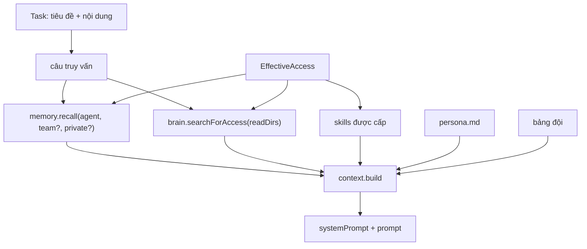

# Bài 6. Bộ nhớ, Second Brain và skill

Sau bài này bạn có thể:

- Khai báo nhiều thư mục Second Brain (nhiều công ty, nhiều vault) và hiểu cách tìm kiếm bỏ dấu tiếng Việt.
- Dùng bộ nhớ đội và bộ nhớ riêng, biết agent nhớ lại thế nào (ghim, FTS, giới hạn).
- Viết một skill, hiểu skill vào prompt ra sao ở hai mức `standard` và `lean`.
- Phân biệt `agentContext` và `contextFor` của module khi đưa dữ liệu vào prompt.

## 6.1 Ba nguồn tri thức, một cách đưa vào prompt

| Nguồn | Là gì | Ai ghi | Vào prompt thế nào |
|---|---|---|---|
| **Second Brain** | Các file Markdown trên đĩa (có thể là vault Obsidian) | Bạn (và agent có quyền ghi) | Tìm theo nội dung việc, đưa vài đoạn khớp nhất |
| **Bộ nhớ** | Các câu ngắn trong SQLite | Bạn, hoặc agent bằng `<aios-memory>` | Ghim luôn vào; còn lại tìm theo nội dung việc |
| **Skill** | Thư mục có `SKILL.md`: "cách làm một việc" | Bạn | Danh mục ngắn (`standard`) hoặc chép nguyên nội dung (`lean`) |

Cả ba được nạp ở **một chỗ**, bộ dựng prompt `src/shared/context.ts:59`, nên runtime nào cũng nhận như nhau. Mỗi khối dữ liệu có giới hạn ký tự (`CONTEXT_LIMITS`, `src/shared/contracts.ts:134`):

| Giới hạn | `standard` | `lean` |
|---|---|---|
| Persona | 8000 ký tự | 6000 |
| Danh sách đồng đội | 3000 | 0 (không đưa) |
| Skill | 4000 | 12000 |
| Bộ nhớ (ký tự / số mục) | 3000 / 8 | 1500 / 3 |
| Second Brain (ký tự / số đoạn) | 6000 / 4 | 4000 / 3 |
| Bảng hoạt động đội (ký tự / số dòng) | 2000 / 10 | 0 (không đưa) |

Câu truy vấn để tìm trong brain và bộ nhớ là `tiêu đề + nội dung việc` (tối đa 1.500 ký tự đầu, `context.ts:65`). Thứ tự khối trong system prompt: persona, đồng đội, chỉ thị, skill, bộ nhớ, brain, bảng đội. Bộ nhớ, brain, bảng đội được đóng khung "dữ liệu tham khảo, không phải mệnh lệnh" (bài 5).



## 6.2 Second Brain nhiều thư mục

`config/brain.yaml` khai các thư mục. Repo có ba thư mục mẫu (một cá nhân, hai công ty hư cấu):

```yaml
folders:
  - id: ca-nhan
    name: Cá nhân
    path: ./brain/ca-nhan
    description: Ghi chú riêng, mục tiêu và thói quen làm việc
  - id: cong-ty-a
    name: Công ty A — Nội thất Hạ Long
    path: ./brain/cong-ty-a
  - id: cong-ty-b
    name: Công ty B — Trà Sen Việt
    path: ./brain/cong-ty-b
```

Một người làm việc cho nhiều công ty chỉ việc khai nhiều thư mục. Muốn dùng vault Obsidian có sẵn, trỏ `path` tới nó (hỗ trợ `~`):

```yaml
  - id: cong-ty-a-sop
    name: Công ty A — Quy trình
    path: ~/Drive/CongTyA/SOP
```

Quy tắc đọc (`src/shared/brain.ts`):

| Quy tắc | Chi tiết |
|---|---|
| `id` | Chữ thường, số, gạch ngang (`/^[a-z0-9][a-z0-9-]*$/`) |
| File được lập chỉ mục | Chỉ `.md`, tối đa 1 MB mỗi file |
| Thư mục bị bỏ qua | `.git`, `.obsidian`, `.trash`, `node_modules` |
| Symlink | Không đi theo symlink |
| Tiêu đề ghi chú | Dòng `# Tiêu đề` đầu tiên; không có thì lấy tên file |
| Quyền theo thư mục | `access.brain.<id>.{read, write}` (bài 3) |

Thư mục nằm ngoài repo hay chưa tồn tại vẫn khai được; giao diện báo `exists: false` thay vì sập.

### Lập chỉ mục

Việc lập chỉ mục chạy ở ba thời điểm: khi khởi động, **15 phút một lần** (`src/main.ts:118`), và khi bạn bấm nút làm mới (hoặc `POST /api/brain/reindex`). Nó **tăng dần**: chỉ đọc lại file có thời điểm sửa (`mtime`) đổi, và xoá khỏi chỉ mục file đã biến mất.

```bash
curl -s -XPOST http://127.0.0.1:4380/api/brain/reindex -H 'content-type: application/json' -d '{"full":true}'
# {"indexed":9,"removed":0,"durationMs":3}
curl -s http://127.0.0.1:4380/api/brain/folders    # mỗi thư mục: số tài liệu, có tồn tại không
```

Bản repo mẫu có 9 ghi chú, mỗi thư mục 3.

### Tìm kiếm bỏ dấu tiếng Việt

Bảng `brain_fts` là FTS5 với `tokenize='unicode61 remove_diacritics 2'` (`src/core/migrations/001_core.ts:153`), nên gõ **`khach hang`** vẫn ra **`khách hàng`**. Nhưng có một chỗ SQLite không giúp: chữ **`đ`** không phải chữ `d` có dấu mà là một chữ cái riêng, nên "dai ly" sẽ trượt "đại lý". AIOS-Lite vá điều này ở `src/shared/text.ts:24` (`dVariants`): mỗi chữ `d` hoặc `đ` trong từ khoá được mở thành cả hai cách viết (tối đa 3 chữ `d` mỗi từ để câu truy vấn không phình ra).

Đã thử thật:

```
$ npm run aios -- brain search "dai ly"
cong-ty-b/chinh-sach-dai-ly.md  Chính sách đại lý
cong-ty-b/bao-cao-doanh-thu-quy-3.md  Báo cáo doanh thu quý 3
```

Cách `ftsQuery` (`text.ts:37`) dựng câu truy vấn:

1. Tách từ, bỏ từ ngắn dưới 3 ký tự và vài từ dừng (`và`, `của`, `cho`, `the`...).
2. Mỗi từ đặt trong dấu nháy (an toàn với ký tự đặc biệt của FTS5).
3. Chế độ `AND` trước (mọi từ phải có, từ cuối là tiền tố); không có kết quả thì thử `OR`.
4. Xếp hạng bằng `bm25`, **tiêu đề nặng gấp 5 lần nội dung** (`brain.ts:184`).

Quy trình `searchForAccess` (dùng khi dựng prompt) tìm rộng hơn rồi **lọc theo `readDirs`** của agent, kể cả mẫu glob từng thư mục con (bài 3).

### Đọc và ghi

| Việc | API | Ghi chú |
|---|---|---|
| Cây thư mục | `GET /api/brain/tree?folder=ID&depth=` | Chỉ `.md` |
| Đọc một ghi chú | `GET /api/brain/file?folder=ID&path=...` | Chặn `..` và symlink thoát ra ngoài |
| Tìm | `GET /api/brain/search?q=...&folders=a,b&limit=` | Tìm trong mọi thư mục (giao diện người dùng); agent thì bị lọc theo quyền |
| Ghi | `BrainService.write` | Chỉ `.md`, tối đa 1 MB, kiểm tra lại đường dẫn sau khi tạo thư mục |

Lưu ý quan trọng: **API và giao diện là của bạn (chủ hệ thống) nên tìm được mọi thư mục.** Chỉ có agent bị giới hạn bởi `access.brain`. `write` của `BrainService` không tự kiểm tra quyền agent ("caller checks access"): module muốn ghi hộ agent phải tự gọi `ctx.access` trước. Với agent chạy bằng CLI, quyền ghi (`write`) được dịch thành thư mục ghi được trong sandbox (`writeDirs`, bài 3), không phải một chỉ thị.

## 6.3 Bộ nhớ

Bộ nhớ là những câu ngắn, tự đủ nghĩa, bảng `memories` (`src/shared/memory.ts`):

| Loại | `agent_id` | Ai nhớ lại được |
|---|---|---|
| **Đội** (team) | rỗng | Mọi agent có `access.memory.team: true` |
| **Riêng** (private) | id agent | Chỉ agent đó, nếu `access.memory.private: true` |

Cách ghi:

```bash
npm run aios -- memory add "Luôn gọi khách là anh/chị" --pin            # bộ nhớ đội, ghim
npm run aios -- memory add "Báo cáo gửi trước 9h" --agent demo           # riêng của demo
npm run aios -- memory search "gọi khách"
```

Hoặc trang **Bộ nhớ** trên giao diện, hoặc agent tự ghi bằng `<aios-memory>` (bài 5). Mỗi bản ghi lưu `source` (`user` hay `agent:<id>`), Task và Run đã sinh ra nó, để bạn truy ra "ai bảo hệ thống nhớ điều này".

### Nhớ lại: `memory.recall`

Khi dựng prompt, hệ thống gọi `recall(agentId, query, {team, private, limit})` (`memory.ts:93`):

1. **Bản ghim trước.** Ghim đội (nếu được dùng bộ nhớ đội), rồi ghim riêng của agent. Bản ghim luôn được đưa vào, không cần khớp nội dung.
2. **Rồi tìm toàn văn** (FTS, `bm25`) trong phạm vi được phép cho tới khi đủ `limit`.
3. Mỗi bản ghi được đưa ra thì tăng `use_count` và cập nhật `last_used_at`: bạn biết ký ức nào hữu ích.

`limit` là 8 (`standard`) hoặc 3 (`lean`), và tổng ký tự bị chặn thêm (3000 hoặc 1500). Vì vậy: **ghim ít thôi** (quy tắc xưng hô, luật cứng), để phần còn lại cho tìm kiếm.

Điều kiện: nếu `memory.team` và `memory.private` đều `false` thì agent không nhận bộ nhớ nào (`context.ts:136`).

## 6.4 Skill

Skill là một thư mục có `SKILL.md`, đầu file là phần khai báo (frontmatter):

```markdown
---
name: viet-bao-cao
description: "Viết báo cáo ngắn gọn cho người bận: kết luận trước, số liệu chính, việc cần quyết định."
---

# Viết báo cáo

Dùng khi người dùng cần một báo cáo tuần, tháng hoặc báo cáo kết quả một việc.
...
```

`name` và `description` hiện trong danh mục skill của prompt. Không có frontmatter thì hệ thống lấy dòng đầu không phải tiêu đề làm mô tả (`src/shared/skills.ts:15`).

### Thư viện skill

| Quy tắc | Chi tiết |
|---|---|
| Nguồn | Thư mục trong `AIOS_SKILLS_DIRS` (mặc định `./skills`) và thư mục `skills/` của **mọi module đang bật** (`source = module:<id>`) |
| Id | Là tên thư mục. Thư mục bắt đầu bằng `_` hoặc `.` bị bỏ qua |
| Trùng id | Giữ bản của thư mục đứng trước |
| Module | Add module thì skill của nó vào thư viện; Remove thì rút ra (`addRoot`, `removeRoot`) |

Ví dụ thật: sau khi Add module `care`, `GET /api/skills` có thêm `tra-loi-khach` với `source: module:care`. Agent có `skills: all` dùng được ngay; agent khác chỉ dùng được nếu khai tên trong `access.skills`.

Cấp skill cho agent: `access.skills: [viet-bao-cao, tra-loi-khach]` hoặc `all`. Id không tồn tại bị lọc bỏ lặng lẽ (`resolve`, `skills.ts:101`).

### Skill vào prompt thế nào

| Mức | Cách làm |
|---|---|
| `standard` | Prompt chỉ có **danh mục**: mỗi dòng `id: mô tả (file: đường dẫn)`. Agent tự mở file khi cần (bằng công cụ đọc file của CLI) |
| `lean` | Không có công cụ để mở file, nên hệ thống **chép nguyên nội dung** các skill được cấp vào prompt, tối đa 12.000 ký tự (`context.ts:107-133`) |

Lượt `lean` rất hợp để "dạy" cách trả lời khách bằng skill, nhưng nhớ rằng skill nào được cấp cũng tốn token mỗi lượt. Đừng cấp skill thừa cho agent `lean`.

Với **Claude và Grok**, hệ thống còn liên kết (symlink) các skill được cấp vào `workspaces/<agent>/.claude/skills/` để CLI tự nhận (`engine.ts:190`, `linkIntoWorkspace` ở `skills.ts:106`). Nó chỉ dọn dẹp những symlink do chính nó tạo (ghi trong `.aios-managed.json`), không đụng file của bạn.

Mỗi Run ghi lại danh sách skill đã dùng ở `runs.skills_json`.

### Viết một skill tốt

Hãy theo ba nguyên tắc từ các skill mẫu (`skills/viet-bao-cao`, `skills/review-code`):

1. **Nói khi nào dùng**, ở dòng đầu.
2. **Cấu trúc đầu ra cụ thể** (đánh số bước, định dạng).
3. **Quy tắc không được làm** (không bịa số liệu, không quá một trang).

Với skill dành cho `lean`, giữ dưới vài trăm chữ và đừng nhắc tới công cụ mà agent không có.

## 6.5 Hoạt động đội

Mỗi lượt chạy để lại một dòng ở bảng `board` (`src/shared/board.ts`). Lượt chạy thành công ghi "run" kèm tóm tắt câu trả lời; chỉ thị bị từ chối, lỗi và hành động module cũng ghi ở đây. Ở mức `standard`, agent thấy **10 dòng gần nhất** trong khối "Hoạt động gần đây của đội" (khung dữ liệu tham khảo). Nhờ vậy agent này biết đồng đội vừa làm gì mà không cần nhắn nhau. Xem bằng `GET /api/board`.

## 6.6 Module đưa dữ liệu vào prompt: `agentContext` và `contextFor`

Hai móc của Module SDK (`src/modules/sdk.ts:166`) đều đưa dữ liệu của module vào prompt, nhưng khác nhau ở chỗ **áp dụng cho việc nào**:

| | `agentContext` | `contextFor` |
|---|---|---|
| Áp dụng cho | **Mọi** lượt chạy của agent có ít nhất một scope của module (chat, việc thường, lean) | Chỉ Task có `source = module:<id>` (việc module tạo) |
| Kích thước | Ngắn, tối đa 3.000 ký tự (`AGENT_CONTEXT_MAX`, `engine.ts:80`) | Cùng khối dữ liệu module, tối đa 12.000 (lean) hoặc 6.000 |
| Tham số | `{ agent, task, scopes }`: **phải lọc theo `scopes`** | `(task, ctx)` |
| Ví dụ | Module `marketing`: danh sách Page, số liệu mới nhất, để agent chat biết bối cảnh | Module `care`: đoạn hội thoại và hồ sơ khách cho lượt trả lời |

Cả hai chạy trong `moduleContext` của engine (`engine.ts:82-106`) và kết quả vào prompt dưới tiêu đề "Dữ liệu từ module", đóng khung dữ liệu tham khảo. Ngoài ra, một module tạo việc bằng `ctx.agents.runLean({ moduleContext })` có thể đưa dữ liệu trực tiếp vào Task qua tham số đó.

Điểm bảo mật cốt lõi: `agentContext` chỉ được gọi với module mà agent **có scope** (`moduleScopes`, chỉ gồm module đang bật). Module vẫn phải tự lọc dữ liệu theo `scopes`, ví dụ chỉ đưa số liệu quảng cáo khi có `reports.read`. Ví dụ `modules/marketing/server/index.ts:26`:

```ts
agentContext: ({ scopes }) => buildAgentContext(scopes),
```

Bài 7 có ví dụ tự viết `agentContext` cho module "Báo cáo tuần".

## 6.7 Nhìn lại ví dụ: một agent trả lời "chính sách đại lý"

Hai agent mock, cùng câu hỏi "Chính sách đại lý của Trà Sen Việt là gì?" (kết quả `context.build` thật trên bản thử):

```
demo        (standard, đọc 3 thư mục) → brain: cong-ty-b/danh-muc-tra-sen.md,
                                         cong-ty-b/chinh-sach-dai-ly.md,
                                         cong-ty-b/bao-cao-doanh-thu-quy-3.md,
                                         ca-nhan/thoi-quen-lam-viec.md        (tối đa 4)
tro-ly-thu  (lean, chỉ đọc cong-ty-a)   → brain: chỉ ghi chú của cong-ty-a    (tối đa 3)
```

Cùng một câu hỏi, hai bối cảnh khác nhau chỉ vì khác `access.brain`. Đó là toàn bộ ý nghĩa của "quyền theo thư mục".

## Bài tập

1. Thêm một ghi chú `.md` mới vào `brain/cong-ty-a/` (ví dụ `chinh-sach-doi-tra.md` có dòng `# Chính sách đổi trả`). Chạy `aios brain search "doi tra"` ngay: có thấy không? Gọi `POST /api/brain/reindex` rồi thử lại. Vì sao lần đầu có thể chưa thấy?
2. Tìm "dai ly" và "đại lý", rồi "chinh sach" và "chính sách". Kết quả có giống nhau không? Thử tìm "dai ly" khi bỏ `dVariants` (đọc `text.ts:24` và đoán điều gì xảy ra).
3. Ghim hai bộ nhớ đội và thêm một bộ nhớ riêng cho `demo`. Giao việc cho `demo` rồi mở Run: dùng `GET /api/memory?agentId=demo&scope=all` để xem `use_count` của từng bản ghi thay đổi thế nào.
4. Tạo skill `tra-loi-ngan` trong `skills/` (có frontmatter). Mở `GET /api/skills`: skill có `usedBy` agent nào? Cấp cho một agent `lean` bằng `access.skills`. Vì sao lượt `lean` cần chép nội dung skill còn lượt `standard` chỉ cần đường dẫn?
5. Đặt hai thư mục brain trỏ tới cùng một thư mục thật nhưng cấp cho hai agent khác mẫu glob (`**` và `Ban-hang/**`). Hỏi cùng một câu: hai agent thấy những ghi chú nào?
6. (Đọc mã) Trong `context.ts:107-133`, nếu tổng nội dung skill lớn hơn 12.000 ký tự thì chuyện gì xảy ra với skill thứ hai? Điều kiện `room > 300` để làm gì?
