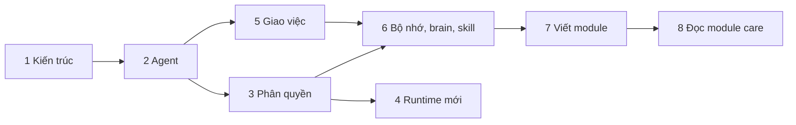

# Bài học AIOS-Lite

Tám bài tiếng Việt đi từ "AIOS-Lite chạy thế nào" đến "tự viết module". Mỗi bài có sơ đồ, tham chiếu mã thật (`đường-dẫn:số-dòng`) và bài tập ở cuối.

Các bài được viết theo đúng mã nguồn hiện tại, và mọi lệnh đã được chạy thử bằng runtime `mock` (agent `demo`), không gọi CLI trả phí. Nếu số dòng lệch đi vì mã đã đổi, hãy tìm theo tên hàm.

## Chuẩn bị

1. Làm theo phần "Cài đặt và chạy" trong [README.md](../../README.md): `npm install`, `cp .env.example .env`, `npm run dev`.
2. Kiểm tra `curl http://127.0.0.1:4380/api/health` trả `{"ok":true,...}`.
3. **Làm bài tập trên một bản sao.** Các bài tập tạo agent, module, bộ nhớ và ghi vào `agents/`, `modules/`, `data/`. Hãy copy repo sang thư mục khác (hoặc dùng nhánh git riêng) để không làm bẩn bản gốc. Với `npm test`, nhớ rằng test đọc thư mục `agents/` thật: thêm agent làm vài test "agent mẫu" báo lệch.
4. Chỉ dùng agent `demo` (runtime `mock`) cho bài tập. Giao việc cho agent `main`, `coder`, `researcher` hay `assistant` sẽ gọi CLI thật và tốn tiền.

## Danh sách bài

| # | Bài | Bạn học được | Thời gian | Cần có |
|---|---|---|---|---|
| 1 | [Kiến trúc AIOS-Lite](01-kien-truc-aios-lite.md) | Bốn tầng và module; một cổng chạy; đi theo một việc từ lúc tạo đến khi xong | 45 phút | README đã chạy được |
| 2 | [Khai báo agent](02-khai-bao-agent.md) | `agent.yaml` từng trường, persona, runtime, `lean` và `standard`; tạo qua giao diện, API, tay | 45 phút | Bài 1 |
| 3 | [Phân quyền](03-phan-quyen.md) | Thư mục Second Brain, bộ nhớ, MCP, scope module; `safe` và `full`; bảng chặn cứng và mềm của từng CLI; nhật ký | 60 phút | Bài 2 |
| 4 | [Thêm runtime mới](04-them-runtime-moi.md) | Interface `Runtime`, bộ chạy tiến trình, JSONL, `doctor`, CLI giả; adapter ví dụ chạy được | 90 phút | Bài 1 và 3, biết TypeScript cơ bản |
| 5 | [Giao việc và chỉ thị](05-giao-viec-va-chi-thi.md) | `<aios-task>`, `<aios-memory>`, `<aios-status>`, `<aios-action>`; giới hạn an toàn; hỏi cả nhóm; lịch; bình luận và duyệt | 60 phút | Bài 1 và 2 |
| 6 | [Bộ nhớ, Second Brain, skill](06-bo-nho-second-brain-skill.md) | Tìm kiếm bỏ dấu; nhớ lại; thư mục brain nhiều công ty; thư viện skill; `agentContext` | 45 phút | Bài 3 và 5 |
| 7 | [Viết module từ `_template`](07-viet-module-tu-template.md) | `module new`, `module.json`, migration, route, `start/stop`, `onTaskFinished`, actions, web; Add, Remove, Purge; test | 120 phút | Bài 1, 3, 5, 6 |
| 8 | [Đọc module `care` làm ví dụ lớn](08-doc-module-care.md) | Cấu trúc thư mục lớn; `careChannels` và `care-kit`; luồng tin đến, lượt lean, nháp, duyệt, gửi; chế độ AI; quyền gửi | 90 phút | Bài 7 |

Tổng cộng khoảng 9 đến 10 giờ, nên chia thành 4 đến 5 buổi.

## Thứ tự đề nghị

Hai lộ trình tuỳ mục tiêu:

| Bạn muốn | Học theo thứ tự |
|---|---|
| **Dùng và cấu hình** một đội agent an toàn | 1, 2, 3, 5, 6 |
| **Mở rộng** hệ thống (module, runtime) | 1, 2, 3, 5, 6, rồi 7, 8; thêm 4 nếu cần CLI mới |
| Chỉ muốn **viết module nhanh** | 1, 3 (mục 3.6), 5 (mục 5.7), 7, rồi 8 để tham khảo |

Gợi ý chia buổi:

| Buổi | Nội dung | Thời gian |
|---|---|---|
| 1 | Bài 1 và 2 | khoảng 1,5 giờ |
| 2 | Bài 3 và 5 | khoảng 2 giờ |
| 3 | Bài 6 và đầu bài 7 | khoảng 2 giờ |
| 4 | Hết bài 7 và bài 8 | khoảng 2,5 giờ |
| 5 (nâng cao) | Bài 4 | khoảng 1,5 giờ |

## Cách học hiệu quả

- **Mở mã song song.** Mỗi bài trích dẫn file và dòng; mở chúng trong trình soạn thảo khi đọc. Đọc 20 dòng mã thật có ích hơn đọc 200 dòng giải thích.
- **Chạy lệnh trước khi đọc kết quả.** Hầu hết ví dụ có kết quả thật dán kèm: hãy tự chạy và so sánh.
- **Làm bài tập.** Mỗi bài có 5 đến 6 bài tập, từ chạy thử đến đọc mã. Bài tập "đọc mã" là chỗ bạn thật sự hiểu thiết kế.
- **Khi lệch với tài liệu, tin mã.** Tài liệu thiết kế (`docs/ARCHITECTURE.md`, `docs/MODULES.md`) mô tả ý định; các bài học mô tả những gì mã đang làm. Hai nơi có thể lệch nhau chút ít khi mã tiến lên.

## Tài liệu liên quan

| File | Nội dung |
|---|---|
| [README.md](../../README.md) | Cài đặt, chạy, các lệnh |
| [docs/ARCHITECTURE.md](../ARCHITECTURE.md) | Thiết kế chi tiết và lý do |
| [docs/MODULES.md](../MODULES.md) | Danh mục năm module và quy ước chung cho module trả lời khách |
| [docs/dev/API.md](../dev/API.md) | Hợp đồng REST và SSE |
| [docs/dev/runtime-verification.md](../dev/runtime-verification.md) | Kết quả kiểm thật bốn CLI (nguồn của bảng chặn ở bài 3) |
| [THIRD_PARTY_NOTICES.md](../../THIRD_PARTY_NOTICES.md) | Nguồn gốc mã và giấy phép |
